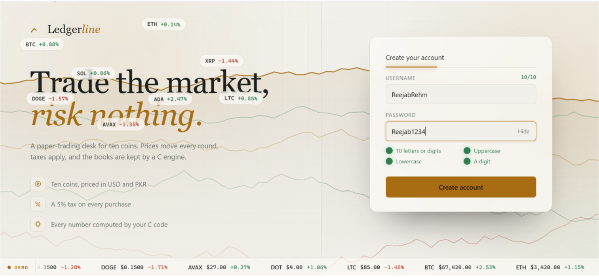
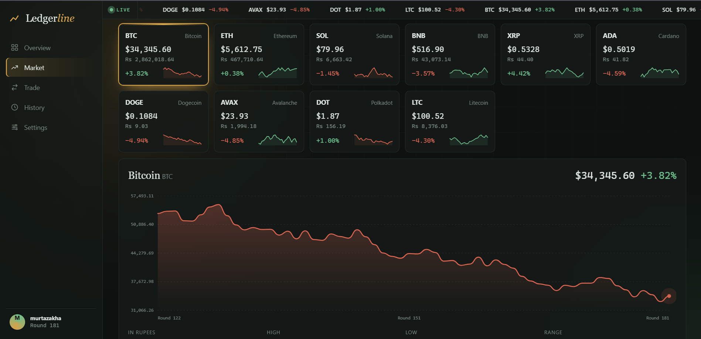
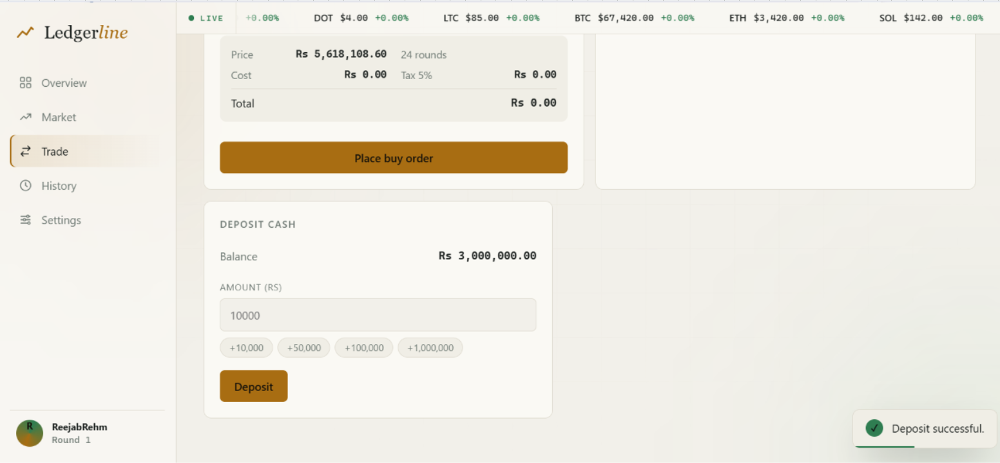
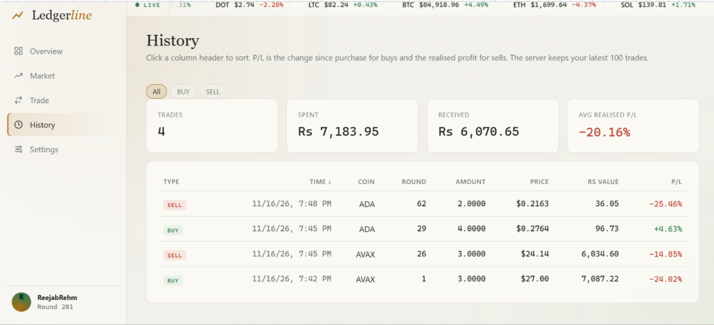
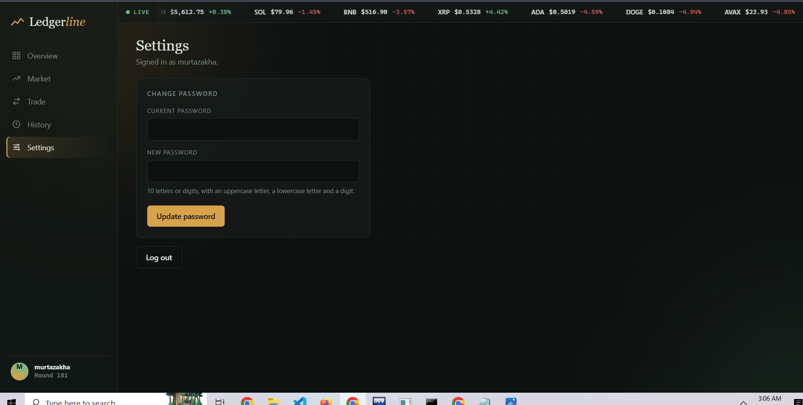

# Crypto Simulator

A C-based cryptocurrency trading simulator built as a **Programming Fundamentals (CT-175) CCA project**. Users can create accounts, manage wallets, buy and sell cryptocurrencies, track transactions, and watch changing market prices.

The core program is written in C and can run in the console. An optional web-based GUI connects to the same C logic through a small server written in C.


## Group Members (Group No. 10)

| Name | Roll No. |
|---|---|
| Muhammad Murtaza Khan | CT-26283 |
| Reejab Rehman | CT-26273 |
| Khola Faysal | CT-26257 |
| Dua Ahmed | CT-26253 |

## Features

- User registration and login with input validation
- Password changing
- Wallet management and cash deposits
- Market display for 10 cryptocurrencies
- Buying and selling cryptocurrencies with a 5% transaction tax
- Random cryptocurrency price updates
- Cryptocurrency price graphs
- Trading history with sorting
- File handling to save and load account, wallet, and market data

## Project Files

| File | Purpose |
|---|---|
| `crypto_gui/crypto_simulator.c` | Main simulator logic (backend, also runs as a console program) |
| `crypto_gui/server.c` | C server that connects the GUI to the backend (it includes `crypto_simulator.c`) |
| `crypto_gui/index.html` | Graphical user interface |
| `flowchart.pdf` | Program flowchart |
| `PF_CCP_Report.pdf` | Project report |

Keep `crypto_simulator.c`, `server.c`, and `index.html` in the same folder.

## How to Compile and Run

**Requirements:** GCC compiler (e.g., MinGW on Windows).

### Option 1: GUI version

1. Open the `crypto_gui` folder in File Explorer.
2. Click the address bar, type `cmd`, and press Enter.
3. Compile the server:
   ```
   gcc server.c -o server.exe -lws2_32 -lm
   ```
4. Run it:
   ```
   server.exe
   ```
5. Open **http://localhost:8080** in Chrome or any browser to use the GUI.

On Linux/macOS, compile with `gcc server.c -o server -lm` and run `./server`.

### Option 2: Console version

In the same folder:

```
gcc crypto_simulator.c -o crypto_simulator.exe -lm
crypto_simulator.exe
```

The program creates `account.txt`, `wallet.txt`, and `market.txt` on first use. A new market is generated automatically if no saved data exists.

## Sample Input and Output

When the console program starts, it shows the pre-login menu:

```
========== CRYPTO SIMULATOR ==========
1. Sign-up
2. Log-in
3. Exit
Enter your choice:
```

Sign-up rules (validated by the program):

- Username: exactly 10 letters
- Password: exactly 10 characters, with at least one uppercase letter, one lowercase letter, and one digit

After a successful login, the main menu offers options 1 to 12: wallet, deposit, market prices, price graph, new market round, buy, sell, conversion, trading history, sort history, change password, and logout.

## Screenshots

**Login**



**Market**



**Trade menu**



**Trading history**



**Settings**



More example sessions and test cases are in the project report.

## Programming Fundamentals Concepts Used

- Variables and data types
- Input and output
- Conditional statements (if-else) and switch statements
- Loops
- Functions and recursion
- Arrays and strings
- Structures
- Pointers and double pointers
- Dynamic memory allocation
- File handling
- Sorting
- Input validation

## Folder Structure

```
.
├── Readme.md
├── LICENSE
├── .gitignore
├── PF_CCP_Report.pdf
├── flowchart.pdf
├── screenshots/
│   ├── dashboard.png
│   ├── history.png
│   ├── login.png
│   ├── market_dark.png
│   ├── settings_dark.png
│   └── trade_menu.png
└── crypto_gui/
    ├── crypto_simulator.c
    ├── index.html
    └── server.c
```
