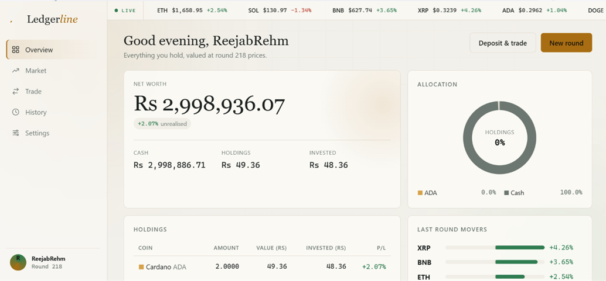

# Crypto Simulator

A C-based cryptocurrency trading simulator built as a **Programming Fundamentals (CT-175) CCA project**. Users can create accounts, manage wallets, buy and sell cryptocurrencies, track transactions, and watch changing market prices. A web-based GUI connects to the C backend through a small server written in C.


## Group Members (Group No. 10)

| Name | Roll No. |
|---|---|
| Muhammad Murtaza | CT-26283 |
| Reejab Rehman | CT-26273 |
| Khola Faysal | CT-26257 |
| Dua Ahmed | CT-XXXXX |

## Features

- User registration and login with input validation
- Password changing
- Wallet management and cash deposits
- Market display for 10 cryptocurrencies
- Buying and selling cryptocurrencies with a 5% transaction tax
- Random cryptocurrency price updates
- Cryptocurrency price graphs
- Trading history with sorting
- File handling to save and load account, wallet, and market data

## Project Files

| File | Purpose |
|---|---|
| `crypto_simulator.c` | Main simulator logic (backend) |
| `server.c` | C server that connects the GUI to the backend |
| `index.html` | Graphical user interface |

## How to Compile and Run

**Requirements:** Windows, GCC compiler (e.g., MinGW). The server uses Winsock, so it is Windows-only.

1. Open the `crypto_gui` folder in File Explorer.
2. Click the address bar, type `cmd`, and press Enter.
3. Compile the server:
   ```
   gcc server.c -o server.exe -lws2_32
   ```
4. Run it:
   ```
   server.exe
   ```
5. Open **http://localhost:8080** in Chrome or any browser to use the GUI.

## Sample Input and Output

```

```

## Programming Fundamentals Concepts Used

- Variables and data types
- Input and output
- Conditional statements (if-else) and switch statements
- Loops
- Functions
- Arrays and strings
- Structures
- Pointers and double pointers
- Dynamic memory allocation
- File handling
- Sorting and searching
- Input validation

## Folder Structure

```
PF_CCA_Project_GroupNo.10/
├── Project_Report.pdf
├── Flowchart.pdf
├── README.md
├── screenshots/
│   └── main-menu.png
└── crypto_gui/
    ├── crypto_simulator.c
    ├── index.html
    └── server.c
```